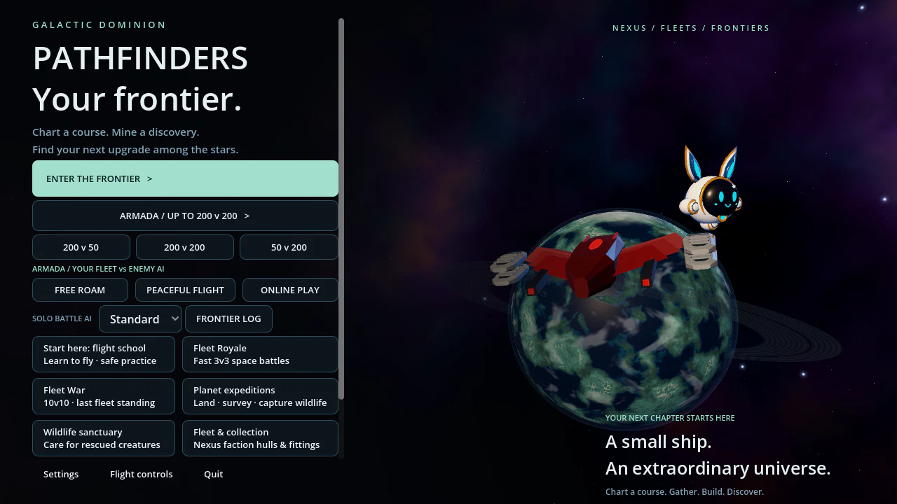

# Galactic Dominion — Armada Presets

A Godot 4.6.3 space-combat and exploration prototype with permanent online ship recruitment, customizable 50-ship PvP fleets, solo 1–200 fighter fleets, five ship classes, Nexus faction hulls, orbiting companions, wildlife expeditions and a personal sanctuary. GDScript and procedural 3D assets; no paid packages required.

## Play

Download [v0.46.0](https://github.com/trentsmith/Galactic-Dominion/releases/tag/v0.46.0), extract the entire client ZIP, and run **GalacticDominion.exe** on Windows or **GalacticDominion.x86_64** on Linux. Players do not need Godot. Back up your commander profile before upgrading: schema 11 reads previous saves, but older builds cannot read new saves.

For source development, clone the `phase-46-recruitment` branch. Open **Godot 4.6.3 → Import → project.godot → Import & Edit**, then press **F5**. Open-world flight is now the main menu's primary action.

## New in v0.45 — Armada Presets

Large fleet battles have prominent shortcuts on the main menu:

| Preset | Your fleet | Enemy fleet | Total ships |
| --- | --- | --- | --- |
| **200 v 50** | You + 199 allied AI | 50 enemy AI | 250 |
| **200 v 200** | You + 199 allied AI | 200 enemy AI | 400 |
| **50 v 200** | You + 49 allied AI | 200 enemy AI | 250 |

Click a preset, review **Your fleet / Enemy fleet** and difficulty, then click **LAUNCH**. **ARMADA / UP TO 200 v 200** opens custom setup with independent counts from 1–200. Deploy Again retains both numbers. Fleet Royale remains 3v3; Fleet War remains 10v10. These Armada battles are single-player with AI, including up to 400 ships.

Settings, flight controls and Quit remain visible below the scrolling mode list. The v0.44 dogfight improvements, exploration, wildlife and saved collections are retained. [Armada guide](docs/ARMADA.md).

## Dogfight improvements from v0.44

- **Moving-target lead guide:** Tab favors enemies near your aim. An amber diamond shows where to lead your lasers; it turns mint inside the existing assistance cone. Player laser assistance shares the guide's actual interception calculation.
- **Useful cover:** missile locks require a clear path within 600m. Range, cover, alignment and reload refusals explain what to change; a blocked launch does not start its cooldown.
- **Directional missile alerts:** bearing, distance and an approximate closing estimate identify the most urgent incoming missile. Survey/journey text yields to the warning while your course marker stays visible.
- **Better fleet control:** **[ / ]** cycle every surviving offline ally in 10v10 and Armada. Co-op rows stay separate and distinguish your group from another pilot's ships.
- **Steadier flight camera:** obstacle-aware chase position, frame-independent FOV transitions and visible boost recovery. Empty boost recharges to a usable reserve instead of rapidly pulsing.
- **Comfort options:** Settings adds **Reduce camera motion** and **Show laser lead guide**. Existing combat stats, rare component odds and saved collections remain intact.

[Combat guide, checks and remaining playtests](docs/COMBAT_HANDLING.md).

## Previous polish improvements

- Failed checkpoints keep the current flight open until you retry or explicitly leave. Activity changes also protect unextracted surveys; completed deliveries return normally.
- Keyboard, mouse and gamepad button remaps persist independently. Combat prompts show your current controls.
- Completed jobs, deposits and caches stop drawing stale course markers. Claimed badges clear their pinned reminder, and empty atlas searches explain what to try.
- Mining refuses blocked or out-of-range tractor actions with a specific explanation, and its prompt no longer overlaps the component-recovery prompt.
- Co-op participation follows accounts across ship changes. Reward retries finish before departures unlock accounts, including a disconnect or a lost reply during payment. Team pings expire locally when snapshots stop.
- Unchanged autosaves skip unnecessary file writes; manual saves and failed-write retries still write normally.

[Polish guide, checks and limitations](docs/POLISH.md).

## Exploration and navigation

**O → Field atlas** remembers useful destinations, surveyed places and creature records. Resource contacts respect sensor range. Search/filter, set a course with distance/bearing guidance, save up to twelve personal beacons, or right-click the **J** chart to drop a waypoint.

**Space mining:** shoot a glowing vein to fracture it, then hold **F for one second within 75m** with a clear path. Ore, crystal and alloy feed your home workshop, including Vector Engine and Crystal Shield recipes. Completed deposits save; legendary/mythic relic odds are unchanged.

**O → Journey & badges:** eight optional goals, pinned or completely unpinned, with one-time salvage rewards. **P / middle click / right-stick press** pings your aim for allies; Shift+P sends Danger and Ctrl+P sends Regroup.

**Continue** restores your mode at the last serviced station and optional job progress. Checkpoints save every twelve seconds and when leaving/quitting; they start fresh NPC fleets rather than restoring an entire universe. Unsecured wreck data and unextracted surveys still require their normal exit/delivery. [Guide and save boundaries](docs/PATHFINDERS.md).

[Eight-game comparison, implemented gaps and remaining priorities](docs/GAMEPLAY_REVIEW.md). This is a focused comparison of relevant games, not a claim to have analyzed every popular game.

## Fly your own course

Choose **Enter the Frontier**, then **O** for optional jobs, faction standing, companion protocols and home facilities. There is no mandatory campaign checklist. Peaceful Flight keeps raids and environmental damage off.

- Rescue pods and repair disabled vessels: **hold F** with a clear path within **90m** (three or four seconds).
- Escort couriers: stay within **150m** and clear hostile jammers inside **110m**.
- Board a wreck: **F within 100m**, outside combat. Walk with your bot, hold **G within 4m for two seconds** at each of three consoles, avoid the pulsed security grid, then **E within 6m of the airlock** to return with the black box.
- Decode component rumors after your first job or observatory upgrade. Recover the indicated real cache with **K**; clues do not guarantee a rare part.
- After three completed jobs, combat-board batches can offer a siege captain. Break its three amber anchors to remove armor, then defeat it. Peaceful batches offer couriers instead.

Five completed slots generate a new board. Jobs have six-minute windows. Completed rewards save immediately and retry if saving fails. Abandoning, timing out or leaving an unfinished job gives no reward; job checkpoints can be continued at your last safe dock. [Frontier guide and implementation](docs/FRONTIER.md).

## Reputation, companions and home

Job completion adds **8 standing** with its patron; destroying a faction patrol costs **4**. At **+24** its patrols become friendly in solo space. At **−20** a faction intercepts you when you enter its sectors, once per sector per flight.

Equip a non-human officer in **Fleet & collection → Crew** to spawn an orbiter. Choose its protocol in O: **Striker**, **Scout**, **Guardian** or **Engineer**. Protocols apply on the next deployment. Human crew do not spawn bots. Scouts extend salvage sensing; guardians intercept a nearby hostile missile every eight seconds; engineers repair hull after incoming damage stops. Support roles trade some attack damage for their utility.

Spend salvage on a **repair dock**, **observatory/gallery** or **workshop** (three levels each). The workshop consumes sanctuary ore, fiber and bloom to fabricate selected permanent standard blueprints. Fit them in Fleet Hangar for your next deployment. Local facilities, mining and roles stay separate from online accounts.

## Land, track and rescue wildlife

Choose **Planet expeditions**, or approach an owned planet in solo flight and press **L**. **J** opens the chart and landing bot picker. **T** selects a species to track; its recent movement leaves a bounded footprint trail. Distant predators can hunt nearby passive wildlife away from your current encounter.

Hold **G for two seconds within 12m** to scan. **LMB** stuns dangerous animals non-lethally; **C within 8m** captures a surveyed eligible creature. Dangerous fauna must reach half health first. **E within 10m of your landing ship** delivers surveys and secured cargo to the sanctuary. **B** switches exploring bots at the ship; **F** gathers seeds. R/N/V/Z deploy, select, attack with and recall your surface creature party. Delivery failures remain retryable. Creatures stay out of space combat; orbiting bot companions remain active.

Planet animals retain restrained biological faces. Your bot companions keep their expressive faces. Landed trips return to the same orbital session.

## Online and other modes

**Recruit → Customize → Fleet Duel:** sign in through **Online**, hire permanent vessels with salvage in **Recruitment**, then customize and assign up to **50 owned ships** in **Battle Fleet**. Each ship keeps its own component, crew and appearance fittings; inspect its resulting combat stats in the menu. Keep 200 vessels in reserve/active combined. Two commanders on opposing teams ready up and the leader launches **FLEET DUEL**. Each pilots one ship and commands their AI wingmates. Unequal lineups are supported; both sides keep their ships after defeat. Victory hull blueprints can be commissioned into owned vessels or traded unused. Start with three issued ships and recruit more as you earn salvage. [Fleet recruitment guide](docs/FLEET_RECRUITMENT.md).

**Online → Launch Co-op Frontier** creates one allied team for up to six human pilots, with AI in empty ship slots. The lobby leader starts shared rescue, repair or escort work from O. The combat host validates participation, and the account service grants each eligible pilot a fixed reward once per event. Players may join an already running space session. PvP Free Roam, Fleet Royale, public profiles and trading remain available. Update clients and server together. [Windows PC hosting](server/README.md).

**Planet and wreck interiors are solo-only.** Fleet Duel has two human commanders and up to 98 AI wingmates; existing Free Roam/Co-op/Royale have up to six human pilot slots. Armada uses allied/enemy AI. The self-hosted combat host is trusted and commercial anti-cheat hardening remains pending.

**Armada:** choose 1–200 fighters per side, asymmetric fleets, randomized sectors, asteroids, stars, black holes and temporary mega weapons. **Fleet Royale/Fleet War:** 3v3 or 10v10 last fleet standing. **Flight School:** safe interactive tutorial. [Armada](docs/ARMADA.md), [AI tuning](docs/ARMADA_AI.md).

## Rare ship parts

Hold **K for two seconds within 60m** of a gold space cache (6m on a planet). The first cache guarantees an uncommon part; twelve discoveries refresh a batch. Schematics save immediately, and duplicates grant 15 salvage. Later odds remain **legendary tier 1/4,096; mythic tier 1/65,536**. No pity guarantee or rumor bonus changes these rolls. Local discoveries remain separate from the online marketplace. [Exact odds](docs/COMPONENT_DISCOVERY.md).

## Controls and settings

W/S thrust/reverse; A/D strafe; Space/Ctrl vertical movement; mouse aim; Q/E roll; Shift boost. LMB laser, **M missile**, R ability, Tab target. F1–F3 switch lead ships; 1–5 give orders. Fleet Duel, offline 10v10 and Armada use [ / ] to cycle every surviving ally. J chart, G scan/service, K recover parts, F job interaction, O Frontier board, H scenic HUD, Esc menu. Online flight continues while menus are open.

Settings has **Low/Medium/High** graphics, larger menu text, reduced explosion flashes, mouse sensitivity/inversion, volume, fullscreen and input rebinding. Gamepad defaults: left stick moves, right stick aims, triggers fire, bumpers move vertically, A boosts, Y targets, X activates abilities, D-pad up scans/interacts, Back opens the Frontier board, B captures on planets. Other actions can be assigned under **Controls / Rebind Inputs**. Axis defaults remain fixed; key, mouse and gamepad button bindings can be changed. Hardware controller feel still needs human playtesting.

## Archived campaign

The authored **Fractured Relay** and biological story are retained with their saves. `gameplay/campaign_enabled=false` disables campaign guidance and progression hooks by default. Developers can re-enable it with that setting or `GD_ENABLE_CAMPAIGN=1`; the older `GD_ENABLE_CREATURES=1` development mode also enables its campaign. Wildlife and companion flags remain independent.

Past endings have small free-roam consequences: Seal adds a reconstruction tender's repair aura near Vesper; Preserve adds a contained memory echo and longer salvage bearings. No previous campaign is required to explore or progress. [Archived narrative](docs/NEXUS_FLEET_CAMPAIGN.md).

## Validation

Recruitment validation covers transactional server ownership, migration, fifty-ship limits, per-vessel fittings, all 100 duel spawns, compact packet budgets and fleet-wide combat credit. Actual two-client ENet tests cover 50v50, asymmetric 7v50, disconnect forfeits and reward retries; a normal live 50v50 and retained six-client/co-op paths are also exercised. The Armada preset regression verifies all three requested 200-ship formats. Release CI exports both platforms and checks the Linux game/server alongside the broader combat, exploration and creature regressions. Native Linux menu captures check layout. Windows GUI, Internet hosting, physical controllers and sustained human balance/performance playtests remain pending. [Fleet test commands and limits](docs/FLEET_RECRUITMENT.md#validation).
