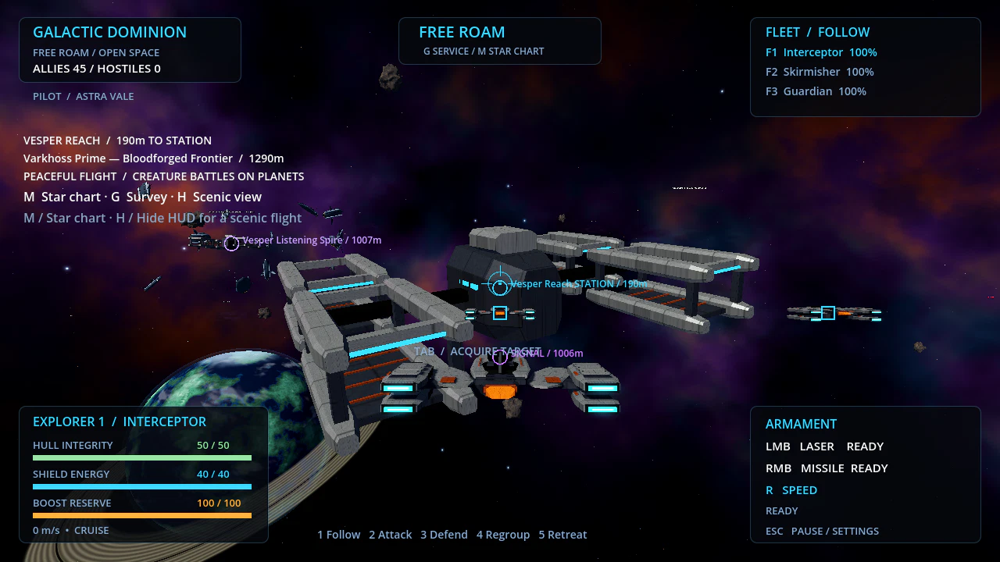

# Galactic Dominion — Custom Fleet Wars

A Godot 4.x 3D space game prototype with cute original cartoon ships, orbiting alien companions, offline/online free roam, Fleet Royale, exploration, a persistent fleet hangar, collectible crew, interchangeable components, rare appearances, server-hosted 3v3 combat, public online profiles and a player marketplace. Uses original procedural 3D meshes and GDScript. Validated with Godot 4.6.3. No plugins or paid assets are required. Offline modes require no network access.

## Choose your Armada matchup

The main **ARMADA / CHOOSE YOUR FLEETS** action opens separate number fields for **your fleet** and the **enemy fleet**. Each accepts 1–200 fighters. Your count includes the ship you pilot; the remaining ships are AI. Presets include 200v200, 200v50, 50v200 and 50v50. Counts are saved when launching and preserved by replay. The sector chart, HUD and match reports show the actual matchup. Online remains six pilot slots.

Armada enemies now use a consistent predictive interception point for steering and firing, retain targets to avoid resetting missile locks, and check firing paths for obstacles and friendly ships. Standard/Veteran use full enemy durability and matching missile capabilities. Relaxed keeps its easier durability/reaction tuning; smaller 3v3/10v10 modes retain their own balance. For a stronger challenge choose **Veteran** or **50 allies versus 200 enemies**. [Actual comparison results and tuning notes](docs/ARMADA_AI.md).

## More natural creature faces

All nine wildlife species now use surface-mounted eyes with upper/lower lids, reflective corneas, detailed irises and species-specific pupils. Stags have lateral eyes and horizontal pupils; prowlers have longer muzzles; bats have a nasal leaf and shorter ears; aquatic species use small lateral eyes and ventral mouths. Painted rosy cheeks and the shared cartoon smile are replaced by neutral facial anatomy. Eldritch creatures retain their own sensory structures.

Coats have softer organic markings, fine surface variation, muzzle shading and different fur/aquatic/bell material finishes. Wild creatures, deployed companions and sanctuary residents share a smooth blink with timing offsets. Growth forms inherit the same face. Shared skin materials and cached iris geometry keep detail bounded. Portable glTF models receive baked coat colors and retain the real facial meshes.

Choose **Planet expeditions** on the title screen to see wildlife, or **Your little planet** to view sanctuary residents. This pass uses stylized naturalism with original procedural geometry; fur strands, skeletal facial rigs and photorealistic scanned assets are not part of it. [Art and rendering notes](docs/CREATURE_ART.md).

## 200v200 Uncharted Armada

**ARMADA / CHOOSE YOUR FLEETS** is the main title-screen action. The default 200v200 matchup has one human pilot and 199 AI allies facing 200 AI enemies in a randomized sector with a 5,200m starting radius. This replaces the earlier 100v100 launch option; solo 3v3, 10v10 and the story remain available. Online play retains six pilot slots.

Each deployment generates new squadron spawns, sixteen asteroid fields, hundreds of physical asteroids, two stars, two black holes and eight relic sites. Opponents are initially beyond your sensors. **Tab** can only select contacts within **1,100m**. **J** opens an X/Z sector chart showing terrain, hazards, allies and locally detected enemies; it does not reveal the whole opposing fleet. Flight continues while the chart is open.

Stars pull ships inward and create sideways momentum; their hot cores cause labelled damage. Black holes have a larger pull zone and a lethal event horizon. Warnings identify nearby hazards. Boost away before reaching the core. Both teams face the same hazards, and AI attempts to steer around them. All physics are arcade gameplay rules.

Find Solar Lance or Gravity Nova relics within 32m; **B** fires three match-local charges with a 12-second recharge. Relics return after 90 seconds. **F1–F10** selects the first ten allies; **[ / ]** cycles through all survivors. The last fleet standing wins. The safe zone eventually collapses to prevent hiding.

Detailed reinforcement hulls merge into shared class meshes and materials. A 10 Hz spatial index replaces repeated whole-fleet AI scans, obstacle probes are cached, nearby support/Guardian queries use the index, and relic checks run on a bounded interval. Controlled ships retain their full model and fitted appearance. These changes reduce redundant work; they do not establish a rendered FPS guarantee. See [Armada implementation and controls](docs/ARMADA.md).

## Begin your story

Choose **Begin your story** on the command deck, or press **O** during solo play. The first discovery now starts in peaceful roaming space: follow the gold Varkhoss landing waypoint and press **L** near the outpost. Surface waypoints follow the tracked individual and then guide secured rescue cargo home. Astra grants exploration landing clearance on Varkhoss, avoiding a conquest requirement. **The Lantern Signal** is a seven-objective opening chapter: answer Commander Astra, discover Varkhoss Prime, scan and capture a new creature, deliver it through the landing ship, debrief with Warden Sera, craft and fit Engineer Milo's Sprint Drive to F1, then defeat the named Crimson patrol and return to Astra.

The journal highlights your next step and offers NPC mission dialogue, world lore and practical help. Milo appears as a holographic field NPC near planetary landing sites. His workshop crafts permanent component blueprints from sanctuary materials; Sera reserves a one-time engine kit for the story. The Sprint Drive trades 6% hull for speed and acceleration. Fitting applies on the next deployment. The patrol uses at least Standard AI (or your selected Veteran), without changing your saved difficulty preference.

Only actual sanctuary delivery advances the rescue goal; the starter pet does not count. Only the named patrol victory advances the combat goal. Progress and one-time rewards save locally with rollback on failure. Opening comms pauses solo play; online comms are read-only and never pause the server. This is an original opening chapter with text dialogue and placeholder 3D NPCs, not a complete campaign or voiced cinematics. [Walkthrough and implementation notes](docs/STORY.md).

## Choose your solo difficulty

Choose **Relaxed**, **Standard** or **Veteran** with **Solo Battle AI** on the command deck or in Settings. Your preference is saved and applies to the next solo 3v3 or 10v10 battle. Standard preserves the previous balance; Relaxed gives enemies slower target reactions, shorter bursts and more pauses; Veteran increases reaction, tracking and firing pressure without extra health above Standard. Raw enemy weapon damage and friendly aiming/missile assistance are unchanged. Online, free roam, training and planet encounters are unaffected.

The HUD and results show the actual match preset. After a solo match, optional **Too easy / About right / Too hard** buttons save local playtest feedback alongside match statistics. **Open Local Playtest Reports** opens the folder; nothing uploads automatically. Presets have automated comparison coverage, but **human difficulty tuning is still pending**. See [the playtest guide](docs/DIFFICULTY_PLAYTEST.md) for the actual simulation results and a human testing plan.

## A dependable creature journey

**T** selects a hunt and tracks the same individual until it is captured, disappears or you change species. Approach within **12 m**, get a clear view and **hold G for two seconds**. Dangerous wildlife must be weakened to **50% health or lower** using non-lethal **LMB stun**, or **N** select / **R** deploy / **V** command your creature party. Passive animals stay curious briefly after scanning.

Within **8 m**, **C** captures the displayed eligible target and spends one pod. Pod expenditure and the transport manifest save together: a failed save captures nothing and consumes nothing. Transport holds **four animals** plus seeds, and survives leaving, restarting and bot destruction. It is restored at the next expedition's landing ship. **E within 10 m of the ship** transfers cargo into sanctuary ownership and clears the manifest in one save. Failed delivery preserves cargo; repeated delivery cannot duplicate residents. Unbanked survey rewards remain expedition-local and are lost on bot destruction.

The HUD explains the next step, scan/weakening/pod requirements and the direction home. A ship beacon helps navigation. Refusals explain range, obstacles, storage and saving. Craft pods at the ship through **Esc → Craft Capture Pod**, for one ore and one bloom. Sanctuary capacity remains 48 residents; seed stacks cap at 99. Delivery refuses overflow instead of discarding cargo.

Save schema 6 migrates schemas 1–5 automatically. Older builds refuse to overwrite the newer format. Surface expeditions remain single-player.

## Understand the fight

Combat now reports confirmed shield and hull damage separately. Camera-relative arrows and front/rear/left/right/above/below labels identify attacking ships; collisions, ion storms and the shrinking battle zone use labelled environmental warnings. Shield collapse and critical hull have distinct messages and sounds. Switching ships clears the previous vessel's directional warnings.

Selected targets have numeric hull/shield values, percentages and a lock meter, with larger high-contrast bars over enemies. A lock-ready chime sounds on acquisition; an **incoming missile** warning only appears for hostile tracking missiles aimed at your current ship within 900 metres. Boost and strafe to evade; evasion is not guaranteed. Failed **M** launches explain whether you need a target, a lock or more reload time. Confirmed outgoing hits show a reticle marker and damage amount.

Original layered laser, missile, impact and warning sounds are synthesized locally, with bounded polyphony, alert throttling and the existing master-volume control. They need no external audio assets. Results show survivors, damage dealt/taken, environmental damage, final damage sources for lost ships, and the exact survival score for time-limit tiebreaks. Detailed reports scroll while replay/menu buttons stay visible. Online feedback is replicated from the server and never applies damage on clients. Update the server and players together to v0.35.

## Start here: flight school

Choose **Start here: flight school** on the command deck. Ten guided objectives teach forward flight, strafing, vertical movement, mouse steering, boost, target selection, laser hits, locked missiles, ship switching and fleet orders. Objectives advance through actual actions, rather than a timer. Allies cannot be damaged and the stationary practice drone never attacks. Training has no shrinking zone, time limit or collection rewards.

Press **Esc** to pause, retry the current lesson or skip back to the command deck. Retrying target/weapon practice places the drone 160 metres in front of your ship. Completion is remembered in local settings, and the card becomes **Replay flight school**. The finish screen links to free roam and the first planet, with a brief planet-controls reminder. This release teaches flight/combat; landing and capture remain the existing planet/free-roam flows, rather than new guided lessons. Existing saves and loadouts are preserved. Developer launch shortcut: `-- --tutorial`.

## 10v10 Fleet War

Choose **Fleet War** on the command deck for a twenty-ship solo space battle: one player and nine AI allies against ten AI opponents. Your three fitted ships are joined by seven temporary reinforcements spanning all five classes. **F1–F10** switches to any surviving ally; fleet orders 1–5 apply to the whole team. Destruction automatically transfers control. Reinforcements do not change your collection or saved loadouts.

Fight across a 2.1 km starting battle zone with more asteroids and wreckage. No respawns: the last surviving team wins. After eight minutes the safe sphere collapses to zero over thirty seconds, then damages even ships at the centre until elimination. **Fleet Royale** retains its six-ship 3v3 match and eight-minute score tiebreaker. Online play remains 3v3; Fleet War is currently solo. Missiles remain **M**, star chart **J**. Results scroll to show all twenty ships and Deploy Again repeats the selected mode.

## Solo combat and missile controls

**M fires missiles after target lock. J opens the star chart.** Updated help and HUD labels show these controls. Right-click no longer fires ship missiles; sanctuary orbit controls are unchanged.

Solo Fleet Royale starts the two AI wingmates in Attack mode. Friendly missiles travel at 220 m/s with stronger steering and a 0.8-second lock, and friendly lasers have a slightly wider aim-assist cone. Solo enemies have 15% less hull/shield, 15% longer weapon cooldowns, half shield regeneration, brief firing pauses and a 3.5-second automatic shield-depletion retreat limit. Explicit retreat orders still work. Solo opponents no longer receive free alien attack companions. Enemy stats are cloned, leaving catalog resources untouched.

These combat balance adjustments apply to **offline Fleet Royale and Fleet War**. Online combat and free-roam balance retain their previous values; the M/J bindings apply throughout ship play. This is an accessibility pass, not a human-tested difficulty rating. A full AI skirmish exercised both fleets and destroyed two opposing ships; human playtesting is still needed.

## Industrial fleet redesign

The shared ship bodies are now built from chamfered rectangular armour rather than rounded profiles. The silhouette has a compact cockpit, exposed wing spars, power conduits, four separated engine cassettes, recessed cyan engine strips, overlapping plates, fasteners and subtle panel wear. Standard ships have no decorative spheres or faces. All five classes and compatible collectible liveries use the new underlying hull; themed skin accessories remain available. Functioning engine, muzzle, canopy and shield nodes are preserved.

Orbital harbours use **open docking gantries and service decks**, replacing the giant blue berths and gold hoops visible in the previous chase view. The flight camera is closer and lower, making the player ship easier to read. Gameplay and ship statistics remain the same. This is a stronger procedural visual redesign, not a claim of production-quality reference-image rendering.



## Wilderness expansion

Each of the three expedition planets now has a **4 km diameter exploration area** (2 km radius), with nearby terrain streamed in 240 m tiles. Leave the landing refuge and explore beyond the original survey trail to encounter random plant clusters, instanced meadows, rolling hills, collidable shipwrecks and stone landmarks. Nearby tiles add up to 36 interactive wildlife encounters to the 30 original survey animals. They use the existing nine species, with small size and color variations; this release does not introduce new species IDs. Scan, stun, capture and deliver to the sanctuary as before. The HUD shows distance home.

Offline spaceflight now has 45 ships: your three ships, 21 patrols and 21 civilians. Online space combat remains unchanged; surface expeditions are still single-player. This is a procedural prototype expansion, not a claim of Breath of the Wild's authored content, map size or production quality. Wildlife state survives tile revisits during an expedition; wilderness chunks are regenerated between expeditions.

## Download and play without Godot

The v0.35 alpha release is built automatically on GitHub. Open **[Downloads](https://github.com/trentsmith/Galactic-Dominion/releases/tag/v0.35.0)** and choose:

- **Galactic-Dominion-Windows.zip** for players: extract the ZIP and run `GalacticDominion.exe`. Godot and Python are not needed.
- **Galactic-Dominion-Server-Windows.zip** for the host: extract it and double-click `Start-Server-Windows.bat`. The package includes a portable Python runtime and the exported game engine. Keep its window open.
- Linux player/server ZIPs and SHA256 checksums are available alongside Windows builds.

For friends on your home network, the server window displays the host PC's LAN address. In the game choose Online, enter that address in **Combat server address**, click **Use This Address For A Local-Network Host**, create/sign into your account and Join Open Arena. Ready up; the lobby leader launches Free Roam or Fleet Royale. Your address and commander name are remembered between launches; passwords and tokens are not saved in connection preferences.

If Windows blocks LAN connections, allow the game on Private networks. The host package includes an optional `Allow-LAN-Windows.ps1` setup script with rules restricted to your local subnet on Private networks. It needs an Administrator PowerShell window when used.

Your Windows PC hosts only while the server window is open. This is a six-player alpha with AI, not a globally hosted service. Internet friends need router port forwarding or a VPN and an HTTPS account endpoint; the hosting guide explains the ports and DNS requirements. There is no public server or domain configured in this build.

See **[release instructions](docs/RELEASE.md)** and **[server hosting](server/README.md)**. Developers can rebuild the packages using `python tools/build_release.py --godot PATH --templates TEMPLATE_DIRECTORY --python-embed PYTHON_EMBED_ZIP`. A `server.cfg` next to the standalone executable can preconfigure your host's account URL and combat address before distributing it.

## Open the source project in Godot

1. Install Godot 4.x (the standard version; .NET is not required).
2. Extract the project folder if downloaded as a ZIP.
3. In Godot's Project Manager click **Import**, select `project.godot`, and open it.
4. Press **F5** (Run Project).
5. Click **FREE ROAM / OPEN SPACE** to explore, or **PLAY / DEPLOY FLEET** for Fleet Royale. The mouse is captured for steering; **Esc** pauses and releases it.

From a terminal: `godot --path /path/to/galactic-dominion`.


## Capture rescue and adorable wildlife

- Scans hold onto a valid moving individual instead of jumping to a nearer animal. Passive creatures briefly settle while being scanned.
- **Left-click stun pulses are non-lethal** on surface expeditions. Weakened creatures pause for a three-second capture window. Ordinary fleet and army combat remains unchanged.
- **C TARGET** shows which nearby creature will be captured and whether it needs scanning or stunning. An unready tracked creature no longer blocks another ready animal. The full 8 m radius includes its boundary; solid obstacles still block capture.
- If the mouse was released, click the scene to restore exploration controls. The HUD prompts you when input is inactive.
- At the landing ship, press **Esc → Craft Capture Pod** to spend **1 ore + 1 bloom**, without abandoning the expedition. Existing cargo, save-failure retry and sanctuary delivery remain intact.
- All nine wildlife species have larger glossy eyes/pupils and catchlights, softer palettes/materials, rosy cheeks and smiles. Land animals have fuller faces and rounded muzzles; living wild creatures blink. The shared art also updates sanctuary residents, friendship forms and army visuals. The 83-model pack is regenerated.


## Land, hunt and bring them home

1. Choose **Peaceful Flight** for relaxed solo exploration, or capture a world during normal Free Roam. Approach one of the three explorable planets or its owned outpost outside combat. Choose your explorer in the **Landing Bot Picker**, then press **L** or **Land Ship + Deploy Bot**. Your currently piloted hull and skin appear at the surface landing ship.
2. Press **T** to cycle the active creature species. The hunt display and world-space marker guide you to the nearest living match and show its health and capture requirements. Pause with **Esc** for direct bot/hunt dropdowns.
3. Hold **G** within 12 m to scan, then press **C** within 8 m to capture. Dangerous fauna must first be weakened to half health with the non-lethal stun pulse (**left mouse**). Captures consume pods; a new sanctuary starts with three. Craft more in its Workshop using ore and bloom.
4. Return to the landing ship and press **E** to deliver up to four captured animals and collected seeds. Until delivery, cargo can be lost if the bot is destroyed or you leave. Save failures retain cargo for retry; repeated extraction cannot duplicate residents.
5. Choose **Visit Sanctuary / Meet Your Captures** on the result screen. Your animals join the existing care, production and friendship systems. Leaving the sanctuary restores the same suspended space fleet and war session when the trip began in Free Roam.

**B** switches among your owned exploring bots **at the landing refuge**. It preserves current hull, shield, stamina and cargo. A loaner Pixlet is available if you own no alien bot. Skins do not affect capture rules. This loop is **single-player**; online surface expeditions and upload of local animals to online inventories remain disabled.

## Celestial space and sculpted ships

Space now has a layered teal/indigo nebula sky, warmer/cooler stars, detailed coastlines and oceans, independent drifting cloud shells, restrained blue atmospheric rims and finely banded planetary rings. Asteroids have irregular cratered silhouettes and rough mineral shading; wrecks have exposed conduits, dark engine bells and layered broken armor. These materials update the existing seven-region free-roam world and Fleet Royale arena.

Ships have sculpted rear decks, layered armor, recessed cooling vents, low glass cockpits, inlaid seams, shaped wing panels and tapered ion exhausts. All five classes and every skin use the new shared geometry. Hangar previews start from the front with warm key/cool rim lighting and antialiasing. The 83-model pack is regenerated with the revised ship meshes.


For relaxed sightseeing, choose **Peaceful Flight**, then press **H** to hide the HUD. The normal combat modes retain their rules and obstacles. Existing saves, collectibles and skin compatibility remain intact.

## Every hull, every livery

All **10 livery selections** work on **Interceptor, Skirmisher, Guardian, Bomber and Support**. Orbitot and Glimbloom now have separate ship skins: research each livery for **200 salvage**, then choose it in the **Variant** dropdown. Their companion crew remain separate selections for **180 salvage** each; skin choice does not grant an attack or replace the equipped crew.

Existing Lunaflutter, Cinderbit, Aurora, Ember, Celestial, Starlight and Voidglass unlocks automatically work on all five classes. Their item IDs, ownership, rarity, research cost and trading rules remain intact. Changing hull retains a compatible selected skin. Class statistics, weapons and ability remain those of the chosen hull.


The model ZIP includes **83 GLB + 83 bundled Godot scenes**, including all 45 non-standard skin/hull combinations. The original Lunaflutter/Cinderbit Interceptor filenames remain as `ship_lunaflutter_scout` / `ship_cinderbit_scout`; other skin/hull filenames use `ship_<livery>_<class>`.

## Orbitot and Glimbloom


Research either companion for **180 salvage** in the Hangar, then equip it in a ship's **Crew** slot. Both are uncommon crew; Legendary/Mythic variant odds are unchanged. Existing saves work without migration. Online accounts research and equip against the matching server catalog.

- **Orbitot / Gravity Loop:** pearl/gold shell, six rotating satellites, two tilted orbital rails, a ringed-planet crown and cyan face. Tracking rings deal 5 damage every 2.2 seconds and reduce the target's maximum thrust speed by 35% for 1.5 seconds. Repeated hits refresh, never stack; shields absorb damage normally.
- **Glimbloom / Prism Pulse:** six articulated iridescent crystal petals, five orbiting shards, a forehead prism and a pink face. Pulses deal 8 direct damage every 2.4 seconds, plus 4 to other enemies within 14 m of impact. Obstacles block splash; allies are safe.

Both orbit their equipped ship and attack automatically. The server owns damage and slow effects online; clients animate the models and display replicated signature projectiles. Their new static GLB and editable Godot scenes bring the downloadable model pack to **40 model pairs**. No skeleton or offline animation clips are included; blinking, flutter and orbital motion run in GDScript.

## A new command deck

The v0.15 welcome screen has an animated 3D preview of your configured ship, an orbital planet and a Pixlet companion. A clear **Explore the Galaxy** action starts Free Roam; **Peaceful Flight** launches a calm solo session directly. The remaining modes use compact cards with descriptions, while Settings, Flight Controls and Quit sit in a separate footer. The same deck adapts to pause/resume, with an explicit reminder that online flight continues while menus are open.

The interface uses a consistent dark palette with soft mint accents, clearer typography, quieter borders and visible keyboard focus. Flight details are shorter, retaining nearby destination distances, raid timing and creature counts. Online trading, profiles and all existing game modes remain connected.


## Starlight visuals and peaceful exploration

v0.15 replaces plain wreck boxes with layered hulls, ribs and broken armor; shapes spacecraft with tapered hull profiles and horizontal swept wings; and builds stations as modular orbital harbours. Nine wildlife species have sculpted bodies, curved limbs and expressive faces. Their Kindred/Radiant details still grow from the same residents. Tree canopies use instanced shaped leaves, with branching coral and curved flowers/ferns on the surfaces.

Space has a quieter nebula sky, natural planet colors, layered annular rings, irregular rocks, softer ion mist and distance culling for tiny distant props/planets. Ceramic armor, dark glass and gold metal use different surface responses. Surface lighting casts shadows; the HUD uses subtler panels and narrower flight text.

For a calm solo trip, choose **Free Roam**, press **J**, then **Restart in Peaceful Exploration**. This resets the current flight into a friendly session with no faction raids or ion damage; saved local progress stays intact. World outposts are friendly for solo surface visits. The chart can restart normal faction war. Online play retains its existing combat rules.

Press **H** in Free Roam to hide/restore the HUD and floating labels. It changes presentation only; combat continues unless you chose peaceful exploration. J opens the chart. Neither viewing option uploads local progress to the online inventory.


## Open world faction war

Free Roam now spans **seven connected regions**: Vesper Reach, Kharon Belt, Auralith Drift, Ember Frontier, Pelagian Veil, Bloodforge Expanse and Dreaming Rift. Press **J** for the clickable star chart and destination selector, or fly between them directly. Each region contains a service station, survey landmark, asteroid belt, collidable wreck field and dangerous ion cloud. New coral, industrial and crystalline landmarks distinguish the frontier. There are 21 enemy patrol ships online (plus six human/AI pilot slots); solo adds three fleet ships and twenty-one civilians.

The **Crimson Dominion**, **Pelagian Concord** and **Eldritch Host** send raids against rival-held worlds. The first dispatch happens after 25 seconds, then every minute. Up to three existing NPC ships arrive by hyperspace and engage with normal combat AI, with no creature troops. The HUD and chart show the next raid countdown and recent attacks. The host runs invasions and shares war state with online clients.

Find a survey landmark using HUD markers and distance, then press **G within 100m**. Solo landmark records persist locally; online surveys are session records and award no inventory items. Existing solo signal discoveries and combat rewards remain available. Ion storms deal 5 damage per second through normal shields/hull; leave the glowing cloud to recover. Hostiles, storms and recent damage prevent safe warp/service.

In **solo Free Roam**, conquer a world outpost, approach within 650m outside combat, and select **Land Bot** in M. Deploy onto Varkhoss Prime, Pelagia or Ny’Zaroth, explore its 3D wildlife habitat, then return to the **same suspended orbital session**. Fleet positions, outpost ownership and war state survive the trip. Orbital simulation pauses while on the solo surface; shared online surface exploration and seamless atmospheric flight are not implemented.

The map is finite and fully loaded, with no shrinking battle boundary. Faction territory and raid state last for the current session. Discoveries, collectibles and sanctuary progress persist as before. Online and local inventories stay separate.


## Planet creature battles and ship-only outposts

Creature troops no longer spawn or deploy in space. Hold a ship within 330 m of an uncontested outpost for 30 seconds to capture it; enemy ships contest capture. Space faction raids contain ships only. Legacy online creature deploy messages are rejected by the host. The `CreatureArmy` class remains as a compatibility adapter for outpost ownership snapshots, with no creature units.

On a **single-player Planet Expedition**, deploy up to three owned sanctuary residents. **N** selects a creature, **R** deploys it, **V** orders an attack on tracked wildlife, and **Z** recalls the party. Esc offers a creature selector and the same commands. Companions follow, avoid nearby obstacles, attack and automatically use their species abilities. Wild opponents retaliate and use their own abilities. Combat is real-time, not turn-based.

Owned creatures have HP, attack, defense, movement speed, an affinity and a species ability. Earn XP by subduing wildlife, level from 1 to 50, and retain progression in the local save. Bond and friendship forms also improve combat attributes. Species use Grove, Tide, Ember, Dusk, Aether and Stone affinities; advantages deal 1.75x damage, weaknesses 0.6x, others 1x. See [the combat guide](docs/CREATURE_BATTLES.md) for the full chart and nine abilities.

Companion attacks are nonlethal so wildlife remains capturable. Fainted companions remain owned; return to the landing ship and choose **Esc → Rest Creature Party**. Recall preserves health and ability cooldowns. No permanent creature death, creature trading expansion, human-versus-human surface battles or surface networking is added in this release. Ship crew robots and collectible ship liveries remain separate systems.

## Mechanical ships and the Dreaming Rift

Standard ships across all five classes use faceted hull panels, dark face-free cockpits, twin split nacelles and cyan engine strips. Collectible liveries retain their cosmetic identity on the redesigned hulls. The Dreaming Rift region contains an animated orange-rimmed anomaly, violet energy filaments and warm illumination. It is scenery, not a new travel mechanic. The reference image guided the direction; these remain procedural prototype assets, without production-quality volumetrics or hand-authored textures.


## Friendship and love growth forms

In **My Planet / Creature Sanctuary**, feed, pet and play with residents to build friendship and love. The sidebar shows the next original form and every requirement. Click **Awaken Friendship Form** when ready. Kindred needs friendship 35, love 25, growth 20 and 90 seconds of happy care; Radiant needs 80, 70, 65 and 360 seconds. Happy care accumulates while housed with food 60+ and joy 65+ while the garden is open. Awakening requires food 40+ and joy 65+.

Forms are permanent and keep each resident’s identity and nickname. Kindred adds 15% production; Radiant adds 35%. They add species-specific 3D antlers, petals, fins, manes or tendrils. These are original growth names and designs. They currently apply to sanctuary fauna, not online expedition troops or ship crew bots.

| Species | Kindred | Radiant |
| --- | --- | --- |
| Antlerstag | Petalcrest Stag | Auroracrown Warden |
| Duskbat | Velvetwing | Dawnveil Guide |
| Nightfang | Hearthfang | Embermane Sentinel |
| Lantern Jelly | Lullalume | Pearlveil Lantern |
| Prism Reefgrazer | Coralglide | Tidegarden Keeper |
| Riftfin Hunter | Gleamfin | Mooncurrent Guardian |
| Riftwisp | Whisperglow | Dreamweave Beacon |
| Manyeye | Starlit Seer | Bloomgaze Oracle |
| Veilcrawler | Softveil | Starbloom Weaver |

Schema 4 saves load older schemas 1–3, preserve friendship and provide partial love credit without skipping form requirements. The 3D model pack contains 38 GLB models and 38 editable scenes, including all eighteen growth forms.


## Free-roaming space

**Free Roam / Open Space** loads seven connected regions into one world. Fly directly between the original four regions and three new frontier regions, or open **J** for station warp. There is no shrinking zone, boundary damage, eight-minute timeout or session-ending team elimination. Nearby ship markers and **Tab** targeting are limited to 1,400 metres to keep the view readable.

- Your three configured fleet ships travel together; F1–F3 switching and the five fleet orders work as before.
- Twenty-one AI patrol ships roam seven regions, while seven friendly civilian escorts roam near stations in solo play. Raider factions can fight each other as well as your fleet.
- Approach a station within **180 metres** and press **G** to restore nearby fleet hull, shields and boost. Warp and station service require no nearby hostiles within 650 metres and no recent damage. Warp preserves damage; it does not repair ships.
- Twelve signals grant the existing local exploration discoveries. Approach within 35 metres and **hold G for two seconds**. Signals share saved IDs with Exploration, so rescanning cannot grant duplicate rewards.
- Defeat a three-ship patrol with your fleet to receive a **permanent hull, two discovery rolls and 60 salvage**. The world stays active; new patrols arrive after 45 seconds.
- Destroyed fleet ships redeploy at the nearest station after 12 seconds. Eight seconds of launch protection helps prevent immediate repeat deaths; firing ends protection. Offline **Esc** pause now stops simulation, including the free-roam world.

Online free roam supports **up to six human pilots plus twenty-one AI patrol ships** in the same world. In Online / Lobby / Marketplace, join the server, ready up, and have the leader click **Launch Free Roam**. Additional pilots can join an active free-roam session without interrupting its players. Two three-ship teams remain in this prototype; empty pilot slots use AI and F1–F3 switching cannot take another human's vessel. Warp and service move/repair only your controlled online ship. The server handles movement, damage, travel, service and respawning. Each server-confirmed player kill of a hostile ship grants a permanent hull and discovery rewards, saved immediately; leaving unlocks your inventory for trading. Online landmark surveys are session records with no inventory payout. Loot-bearing signal scans remain local; local exploration and online inventories stay separate.

One server process runs either Fleet Royale or a continuous free-roam session. With no human pilots left, the free-roam session closes and its lobby becomes available again. World positions and encounter waves are session state, while your collected ships, fittings and records persist.

## Personal planet / creature sanctuary

Open **MY PLANET / CREATURE SANCTUARY** from the main menu. This is an original local creature garden inspired by playful pet-care games. You start with **Ruby the Antlerstag**, one meadow, a food planter with a Starberry Bush, some supplies and three capture pods.


These screenshots use an isolated populated preview save to show multiple habitats; a new game starts with the smaller starter garden described above.

**Bring things home:** on a planet expedition, scan a living animal with G, approach within 8m and press **C** to capture it. Predators must have 50% health or less. Each capture spends one saved transport pod; a trip holds up to four animals. Scan a flora specimen, approach within 7m and press **F** for a seed (one of each type per trip). Return to the landing ship and press E to deliver your cargo. Destruction or abandoning the trip loses cargo; used pods remain spent. Repeat extraction cannot duplicate residents.

**Care and growth:** select a resident to feed, pet, play or rename it. Food restores nutrition and energy; affection and play improve happiness, bond and growth. Petting has a five-second cooldown, and play costs energy. Growth changes model size. Use **FOCUS RESIDENT / OVERVIEW** to move between a close-up care camera and planet design. Residents do not die from neglect, and care/production clocks do not run while the garden is closed.

**Design:** name the planet, choose mint/lavender/sunset colors, place habitats on the 24 buildable plots, move them and upgrade them through three levels. RMB drag orbits the camera; the mouse wheel zooms. Choose Build or Move, then click an empty highlighted plot. Meadow gardens house Varkhoss fauna; reef lagoons house aquatic fauna; dream conservatories house eldritch fauna. A habitat holds `2 + 2 × level` residents. Unhoused arrivals wait in a nursery without producing. Planters hold three seeds per level; delivered plants retain their biome-inspired appearance.

**Production:** a housed, nourished and happy creature stores a resource about every 45 active-garden seconds. Growth, bond and habitat levels improve the rate. Plants store food and bloom about every 25 seconds, with planter/growth bonuses. Each resident or plant stores at most twelve harvests; click **COLLECT ALL PRODUCE** to bank them. Use the workshop to craft pods, ore, fiber or food.

| Fauna | Produce |
| --- | --- |
| Ruby Antlerstag | Bloom |
| Duskwing Bat | Fiber |
| Nightfang Prowler | Ore |
| Lantern Jelly | Pearl |
| Prism Reefgrazer | Food |
| Riftfin Hunter | Alloy |
| Rift Wisp | Essence |
| Many-Eyed Watcher | Crystal |
| Veil Crawler | Alloy |

**Make the planet fly:** complete the three flight stages in order:

| Stage | Requirements |
| --- | --- |
| Survey Anchor | 8 ore, 6 fiber, 6 bloom |
| Lift Engines | 15 ore, 10 alloy, 6 pearl |
| Rift Drive | 18 alloy, 12 essence, 10 crystal |

Then choose Varkhoss, Pelagia or Ny’Zaroth orbit and launch for **3 pearl, 3 essence and 5 food**. The island lifts during a five-second travel sequence, its orbit backdrop changes, and its destination saves. Travel is between these three local orbit destinations; free steering in space, multiplayer gardens, breeding and offline production are not implemented.

Local saves now use schema **3**, migrating schemas 1 and 2 while preserving collection and exploration progress. Older game builds refuse to overwrite the newer save. Sanctuary progress and materials are local and separate from the online marketplace.

## Little bot planet expeditions

Choose **PLANET EXPEDITIONS / LITTLE BOTS** from the main menu. Select an owned alien/bot, or use a loaner Pixlet if you have none. The loaner does not grant or consume collectible ownership. This is a local single-player mode with three bounded 220m surface areas; it does not implement seamless orbital landings, shared multiplayer planets or the complete faction systems from the Nexus Archives.

1. **Varkhoss Prime — Bloodforged Frontier:** a crimson forest beside volcanic ridges and Crimson Dominion fortresses. Survey Duskwing Bats, Ruby Antlerstags and dangerous Nightfang Prowlers.
2. **Pelagia — Alien Reef World:** a bioluminescent underwater world of coral, kelp and anemones. Survey Lantern Jellies and Prism Reefgrazers while avoiding Riftfin Hunters. Pelagia is a new prototype name; the other two names come from the supplied lore.
3. **Ny’Zaroth — The Dreaming Abyss:** a watching organic landform, pale streams, floating rocks, alien plants and ruins. Survey Rift Wisps and Many-Eyed Watchers while avoiding Veil Crawlers. Reality fractures reduce gravity for the last eight seconds of each thirty-second cycle, with a HUD warning.

Each planet has **30 wildlife creatures across three species**, passive and dangerous behavior, obstacle steering, and **three flora species**. Fauna can be scanned alive; dead animals respawn after thirty seconds when their home is clear of the bot. Defensive kills do not award farmable salvage.

**Controls:** WASD move, mouse look, Shift sprint, Space jump (Space/Ctrl swim up/down on Pelagia), left-click defensive pulse, hold G for two seconds within 12m to scan an unrecorded specimen, E within 10m of the landing ship to extract, Esc pause. Pulses aim toward the view with a generous assist cone; terrain blocks shots and scans. Wildlife labels identify nearby dangers and show health. Landing refuge protects the bot.

The bot has **60 hull and 35 regenerating shields**. Predators can destroy the deployed bot and end the expedition. Pending surveys are lost on destruction or abandonment; owned collectibles and previous discoveries remain. Return to the ship to bank surveys: each new fauna/flora record grants 25 salvage; all six species grant one additional 25-salvage record and a one-time crew collectible. Repeat visits cannot duplicate discovery/completion rewards. These surface records use the existing local save and remain separate from online progression.

See [Nexus Archives world continuity](docs/NEXUS_ARCHIVES.md) for the supplied Crimson–Eldritch lore and the distinction between playable surface features and future faction abilities.


## Cute cartoon ships and alien companions


**Cinderbit — Comet Pup** has red-and-pearl armor, pointed ears, crescent eyes, four luminous paw pods and a swishing volumetric flame tail. Research the crew for **140 salvage** and equip it in Crew to use **Meteor Nuzzle**, fast amber sparks (9 damage every two seconds, 260m range). Research **Cinderbit Scout** for **200 salvage** and fit it in an Interceptor’s Variant slot for the matching puppy-faced ship. It changes appearance only. Legendary/Mythic drop ticket odds remain unchanged.


**Lunaflutter — Moon Moth** adds four layered pink/lavender 3D wings with animated hinges, faceted crystal antennae, crescent eyes and purple engines. Research the crew for **140 salvage** and equip it in Crew to use **Dream Drift**, slow violet homing sparks (5 damage every 1.6 seconds). Research **Lunaflutter Scout** for **200 salvage** and equip it in the Interceptor’s Variant slot for the matching winged ship. Its appearance leaves combat statistics unchanged. These are new Uncommon crew and Rare appearance entries; Legendary/Mythic ticket odds stay unchanged.


Ships and companions now use pearl armor, warm gold trim, glossy navy faceplates, cyan eyes, swept fins and rounded engine pods inspired by the supplied Pixlet and Lunaflutter references. Each ship class keeps its own silhouette and gameplay. Pixlet is a new researchable Pebble scout companion that orbits and attacks with Scout Spark. The environment has a procedural blue nebula sky, painted planets with atmosphere rims, cratered 3D asteroids and matching service stations. All geometry is original and generated in Godot; no external art packages are required.


Download **Galactic-Dominion-3D-Models.zip** from the release for 38 reusable models: Pixlet, Lunaflutter, Cinderbit, their two scout appearances, five standard ship classes, nine wildlife species, eighteen Kindred/Radiant forms and the station. Each includes a portable `.glb` for Blender/Godot and a self-contained Godot `.tscn`. They are static meshes; blinking, orbiting and combat are animated by the game scripts. Godot outline shaders are preserved in scenes, while GLB uses standard materials. Rebuild the models with `godot --headless --path . --script res://tools/export_models.gd`.

**Equip an alien in a ship's Crew slot** in Fleet Hangar or Online Fleet. Its 3D companion orbits the ship, bobs and blinks, chooses a nearby enemy within 320 metres, and fires real projectiles. A selected enemy takes priority. Shots obey cooldowns, avoid allies, apply shields/hull damage and credit the host ship. Alien attacks are automatic on player and AI ships; online clients only animate companions and render server-owned projectiles. Companions stop attacking when their ship is destroyed and return when it redeploys. Astronauts retain their crew bonuses without spawning an alien companion.

| Species | Companion attack |
| --- | --- |
| Vesperi | 6 damage plasma orb every 1.4 seconds |
| Kharon | 10 damage charged orb every 2.1 seconds |
| Auralith | 4 damage rapid orb every 1.0 second |
| Drakari | 8 damage tracking orb every 1.7 seconds |

These attacks supplement the crew's existing stat bonus. Legendary/Mythic appearances do not increase companion damage or firing speed. To discover your first alien locally, scan the first Vesper signal to find Nyx, then equip Nyx in the hangar. Alien crew can also be researched or discovered through battle rewards.

The images below were captured from the actual Godot renderer. The flight capture parks AI to keep the screenshot reproducible; gameplay runs the patrols normally.


## Faster combat and permanent victory ships

Hull and shields are roughly halved; lasers and missiles hit harder, and shield regeneration is reduced. The eight-minute match ceiling remains. The previous build finished a six-AI match in **56.48 seconds**, versus **235 seconds** before the damage/health changes. This build, which adds alien opponents, completed its test battle in **20.42 simulated seconds**. These are individual simulations, not promised player match lengths; balance still needs interactive playtesting.

| Ship | Hull / Shield | Laser / Missile damage | Distinct role and R ability |
| --- | --- | --- | --- |
| Interceptor | 50 / 40 | 20 / 85 | Fast flanker; speed surge |
| Skirmisher | 75 / 60 | 29 / 85 | Balanced duelist; laser overcharge |
| Guardian | 110 / 120 | 35 / 85 | Slow shield tank; nearby ally protection |
| Bomber | 90 / 65 | 23 / 145 | Missile specialist; rapid missile barrage |
| Support | 95 / 90 | 21 / 70 | Fleet sustain; nearby hull repair |

Every victory grants one uniformly selected hull from these five classes, in addition to discovery rolls. The hull remains in inventory after restarting; duplicates remain additional copies. Offline rewards belong to the local save. Online rewards belong to the server account and can be sold through Marketplace. Fleet-issue starter hulls remain usable even after trading reward copies; unequip a Bomber or Support before selling its last owned copy. Wins grant standard hulls; very rare liveries are separate, tradable appearance collectibles fitted to compatible hulls. Each roll chooses uniformly within its tier, so a particular Mythic appearance is rarer than the overall Mythic rate. No paid rolls or rarity bonuses are present. Existing appearance IDs and saves remain compatible; the former Exotic tier is now called Legendary.

## Galaxy & Network expansion

**Galactic Exploration** takes your configured fleet into four sectors: Vesper Reach, Kharon Belt, Auralith Drift and Ember Frontier. Each sector has a different asteroid layout and planet tint, three scan signals and a hostile patrol. The HUD marks signals and enemies. Approach a signal within 35 metres and **hold G for two seconds** to scan it. Press **J** to open the sector chart and warp, or return to the hangar. The chart does not pause combat; Esc does pause local exploration.

Sector entry, scans and defeated patrols produce one-time discovery records and salvage. Scans reveal specific crew, equipment or hulls, so exploration gives a predictable route to new content. Revisited records do not pay again. Warp redeploys your fleet in the chosen sector. The **Galactic Records** hangar tab lists discoveries and their UTC timestamps.

The new **Bomber** class has heavy missiles and a temporary barrage ability that reduces missile reload time. The **Support** class repairs nearby allied hulls for five seconds. Unlock either in exploration or research its schematic, then select its hull in Fleet Hangar. Rare hull appearances remain cosmetic. Combat now has original synthesized placeholder laser, missile, shield, destruction and menu sounds, with master volume in Settings.

**Online / Lobby / Marketplace** connects to the included self-hosted server. It supports account registration/login, quick-joining the server's open lobby, choosing teams, readiness and 3v3 real-time combat. Up to six human pilots can join; AI fills empty positions and takes over disconnected pilots' ships. The server owns movement, health, shots, target locking, switching and match results. Clients send bounded control input and interpolate server snapshots.

Online Fleet configures server-owned hulls and fittings. Public Profiles shows online fleet, collection/discovery records and lifetime combat totals. Marketplace supports item listings, purchases, offers, acceptance, rejection and cancellation, with escrow and atomic settlement. Local save data cannot be uploaded as tradable online items: **local and online progression are separate**.

For Windows startup, LAN/VPS setup, accounts and trading, see **[server/README.md](server/README.md)**. The full game folder includes **Start-Server-Windows.bat**. You need Python 3.10+ in addition to Godot to host; regular single-player play only requires Godot. No public server was deployed for this build.

## Hangar & Discovery

From the main menu open **FLEET HANGAR / COLLECTION**. Use the fleet buttons or F1–F3 to inspect your three ships, then select fittings from the dropdowns. The rotating 3D preview shows fitted hardware and ship variants. Your base Interceptor, Skirmisher and Guardian remain available permanently.

Each ship has six slots: engine, shield, weapon, utility, crew and variant. The hangar displays the resulting hull, shields, regeneration, speed, turning, boost capacity, laser/missile output and ability recharge. Loadouts affect your next deployed battle. Component schematics can be fitted to multiple ships; a named crew member can serve aboard only one ship. To transfer a crew member, first set their current ship's crew to **Unassigned**.

There are **45 catalog entries**:

- 14 component schematics: four standard and ten alternative fittings, with bonuses and trade-offs.
- 16 crew collectibles: human astronauts and alien companions, including Orbitot and Glimbloom. Every crew member fits every class; a named individual still serves aboard only one fleet ship at a time.
- 10 universal ship liveries: Vanguard, Aurora, Ember, Celestial, Cinderbit, Lunaflutter, Starlight, Voidglass, Orbitot and Glimbloom. Each fits all five hull classes.
- 5 collectible hulls: all five classes can be won and traded. The three starter classes also remain available as fleet issue.

A new commander starts with four standard component schematics, three astronauts and the standard fleet livery: **8 discovered entries**. Open **Collection & Commander** to filter items, inspect portraits and bonuses, edit your commander name, review lifetime combat totals, or research undiscovered standard equipment and crew with salvage.

Complete a battle to gain free discovery rolls and salvage. Victory gives **one permanent random ship hull, 2 collectible rolls and 60 salvage**; defeat or draw gives **1 roll and 30 salvage**. A duplicate adds **15 salvage** and increases that entry's recovery count. Abandoning a match grants no reward. Research provides a predictable route to non-cosmetic equipment and standard crew; the Lunaflutter, Cinderbit, Orbitot and Glimbloom liveries can also be researched, while Legendary and Mythic appearances are discovered in battle salvage.

Per-roll rarity chances: **Mythic 1/16,384 (0.0061%), Legendary 1/4,096 (0.0244%), Rare 819/16,384 (~5%), Uncommon 3,932/16,384 (~24%), Common 11,628/16,384 (~71%)**. These tiers are disjoint. The selected tier picks uniformly among its entries. Legendary and Mythic items are appearance variants; variant crew have the same combat bonus as their standard counterpart. Rare ship variants add distinctive hull colors, fins, trim, rings or energy ribbons without a power bonus.

## Local saving and updates

Loadouts, inventory, discovery timestamps, commander name, salvage and battle statistics save automatically to `user://commander_profile.json`. On Windows this is normally:

```text
%APPDATA%\Godot\app_userdata\Galactic Dominion\commander_profile.json
```

Paste `%APPDATA%\Godot\app_userdata\Galactic Dominion` into File Explorer's address bar to find the folder. Settings remain in `settings.cfg`. Local saves do not synchronize with the separate online account inventory.

Updates use the same Godot application name, so extracting a new build to another folder retains your local profile. The version-2 local save migrates version-1 profiles from the previous build without discarding their inventory. The save uses a versioned format, a temporary file for replacement, and a `.bak` copy of the previous save. Unreadable primary saves are preserved as `.corrupt-*` files before recovery; newer unsupported save versions are preserved with saving disabled. The menu and hangar display save failures rather than silently claiming success. This is a local prototype; saves are editable and not suitable as authoritative multiplayer inventory.

## Test the new features

1. Open Fleet Hangar and inspect each ship and all six slots.
2. Open Collection & Commander; inspect the alien portraits and rare ship variants, including undiscovered entries.
3. Finish a battle and check the reward list. Click **Review Discoveries / Hangar**.
4. Spend salvage researching a component. Fit it, check the changed statistics and preview geometry, then deploy.
5. Assign an unlocked alien to a ship. Unassign an existing crew member to transfer them between ships.
6. Rename the commander. Quit and restart Godot; check that name, inventory, salvage and loadouts remain.
7. If a rare ship appearance drops, fit it to its compatible class and inspect its appearance in the hangar and battle.

## Controls

| Input | Action |
| --- | --- |
| W / S | Forward / reverse thrust |
| A / D | Strafe left / right |
| Space / Ctrl | Ascend / descend |
| Mouse | Steer (relative input with a decaying steering offset) |
| Q / E | Roll |
| Shift | Boost; consumes a regenerating reserve |
| Left mouse button | Hold to fire primary lasers |
| Tab | Cycle enemy targets |
| M | Fire tracking missile after lock |
| R | Ship class ability |
| F1–F3 / F1–F10 in Fleet War | Switch to an allied ship |
| 1 / 2 / 3 / 4 / 5 | Fleet: Follow / Attack selected target / Defend / Regroup / Retreat |
| G | Hold to scan a nearby exploration signal |
| J | Exploration sector chart |
| Esc | Pause/settings; online combat continues while the menu is open |

Keep a selected enemy within the forward cone and within 600 metres for 1.2 seconds to lock missiles. Shields regenerate after four seconds without damage. Destruction of the controlled ship switches to a surviving friendly ship.

## Suggested manual test

- Deploy and use thrust, reverse, strafing, vertical movement, rolling and mouse steering. Release thrust to check drift and gradual deceleration.
- Hold Shift while moving; watch boost reserve drain and recover.
- Tab to select an enemy. Align with it; verify the HUD changes to MISSILE LOCK. Fire lasers and missiles and watch enemy shield and hull bars.
- Switch with F1–F3. The previous vessel should continue flying under AI control. Activate each ability with R: speed surge, weapon overcharge, and the Guardian's 90-metre protective aura.
- Issue each fleet command with 1–5. Attack uses the target selected when the command is issued. Defend intercepts nearby threats; regroup holds formation; retreat prioritizes shield recovery.
- Fly outside the cyan safe-zone rings and verify the warning and increasing damage. Return to the centre to reset exposure.
- Esc pauses combat. Change sensitivity, invert Y, and fullscreen in Settings; resume. Settings persist locally.
- Eliminate the opposing fleet or lose your own to see results, damage totals, kills and projectile accuracy. Test Deploy Again and Main Menu.

## Rules

Six ships spawn in opposing fleets. Friendly AI follows the active pilot and engages nearby enemies; enemies seek the nearest opponent. Depleted shields trigger AI retreat until shields recover. Static asteroids have collisions and AI ray-based avoidance; small debris is decorative.

The spherical zone starts at 600 metres, begins shrinking after 30 seconds, and reaches 95 metres by 7:30. Outside damage starts at 8 per second and increases by 2 per second for each second of continuous exposure. The match lasts at most eight minutes. Fleet elimination decides the winner; at timeout the sum of surviving normalized hull and shield fractions breaks the tie. Equal scores produce a draw.

## Architecture

`scenes/main.tscn` is the entry scene. The battlefield and component scene trees are constructed in GDScript so the prototype needs no imported art dependencies.

- `scripts/ships`: ship composition, Resource statistics, momentum movement and pilot/camera input.
- `scripts/combat`: health/shield signals, extensible weapon specs, cooldowns, swept-ray projectiles, homing and target locking.
- `scripts/ai`: behavior states, nearby perception, patrol steering, obstacle avoidance and alien companion targeting/attacks.
- `scripts/fleet`: control ownership, switching and command propagation.
- `scripts/match`: spawning, ability aura aggregation, timer, team elimination and results.
- `scripts/world`: deterministic arena, safe zone, connected free-roam regions/stations and transient combat effects.
- `scripts/visuals` and `resources/shaders`: shared cartoon materials, outline shader and original 3D alien meshes.
- `scripts/ui`: HUD, projected health/target markers, results, fleet hangar, 3D preview and primitive crew portraits.
- `scripts/progression`: collectible definitions, catalog, fitting validation, stat composition, reward settlement and local profile persistence.
- `scripts/exploration`: Resource-defined sectors, scans, patrol encounters, chart navigation and discovery records.
- `scripts/online`: HTTP account client, ENet lobby, authoritative simulation, bounded inputs and snapshot presentation.
- `server`: Python/SQLite account, profile, escrow/offer/market and combat reward service, plus a cross-platform launcher.
- `resources/collectibles`: 45 reusable `.tres` collectible definitions.
- `resources/ships`: reusable Interceptor, Skirmisher, Guardian, Bomber and Support `.tres` definitions.

Add a ship class by creating another `ShipStats` Resource; the movement and weapon systems read its values. Add weapons by extending `WeaponSpec` and the projectile/weapon behavior. Input ownership is separated from simulation. The online server simulates all ships; clients present snapshots. Prediction and lag compensation are future work.

## Automated checks actually run

- Godot headless editor import and main-menu startup. Restricted-sandbox editor debug sockets were unavailable; script imports and the real renderer completed.
- `tests/smoke_test.gd`: **38 checks passed**, including spawning, switching, abilities, commands, damage, regeneration, laser/missile impacts, momentum, boost, zone escalation, destruction, victory/defeat, timeout and menu cleanup.
- `tests/progression_test.gd`: **51 checks passed**, including catalog integrity, research costs, fitting ownership, wrong-slot rejection and universal livery fitting, crew transfers, Resource isolation, duplicate rewards, save/reload, backup recovery, malformed-save repair, future-version preservation, real hangar callbacks, rare appearance geometry and match reward integration.
- `tests/exploration_test.gd`: **16 checks passed**, including sector spawning, scans, repeat-reward rejection, patrol rewards, warp, hull unlocks, Bomber/Support abilities, discovery persistence, save migration and online UI creation.
- `tests/online_presentation_test.gd`: **11 checks passed** for replicated health, boost, locking, cooldowns, destruction, zone/timer, projectile cleanup, control transfer and correct team-two victory/defeat messages.
- `tests/test_service.py`: **21 Python tests passed** for authentication, single-use tickets, fitting/research rules, listing/offer escrow, simultaneous purchase rejection, public profile privacy and idempotent authoritative rewards.
- `tests/test_network_integration.py`: this build: a real dedicated-server run with **two Godot clients** (the previous build also passed six-client testing), testing authentication, ready lobbies, server-owned movement, switching/ownership, result delivery, protected reward endpoints and persisted rewards. HTTP checks also cover actual service routes for registration, profiles, fittings, offers and trade settlement.
- `tests/test_launcher.py`: a fresh copy of this build imported successfully, generated its private server key, started the account and combat services, passed readiness checks and shut down cleanly.
- `tests/ai_battle_test.gd`: an autonomous six-ship battle completed with a Ravagers victory at **20.42 simulated seconds**, dealing **545.0 total damage**.

- `tests/free_roam_test.gd`: **33 checks passed** for connected world population, indefinite flight, warp validation, repairs, exploration records, permanent rewards, recurring patrols, respawning, launch protection, actual pause and client authority.
- `tests/alien_companion_test.gd`: **22 checks passed** for crew binding, original mesh details, orbit motion, enemy selection, real projectile damage/credit, cooldowns, friendly-fire/range rejection, rare-appearance parity, host destruction/redeployment, preview behavior, save/reload and client authority.
- `tests/test_free_roam_network.py`: **two real Godot clients** verified joining an active world, replicated hull fitting and NPCs, travel, station service, a real automatic companion projectile kill, controlled PvP damage, station respawn, persisted/tradable rewards, inventory unlock and protected server endpoints. The server fixture parks AI and injects PvP damage for reproducibility; the companion projectile itself runs the normal combat code.
- `tests/render_preview.gd` and `tests/render_flight.gd`: actual **1280 × 720 OpenGL renders** inspected using Mesa software rendering. A manual interactive playtest and Internet/VPS deployment were not completed.

Run from the project directory:

```sh
godot --headless --editor --import --path . --quit
godot --headless --path . --script res://tests/smoke_test.gd --fixed-fps 60
godot --headless --path . --script res://tests/progression_test.gd --fixed-fps 60
godot --headless --path . --script res://tests/exploration_test.gd --fixed-fps 60
godot --headless --path . --script res://tests/online_presentation_test.gd --fixed-fps 60
godot --headless --path . --script res://tests/free_roam_test.gd --fixed-fps 60
godot --headless --path . --script res://tests/alien_companion_test.gd --fixed-fps 60
godot --headless --path . --script res://tests/ai_battle_test.gd --fixed-fps 60
python -m unittest discover -s tests -p test_service.py -v
python tests/test_network_integration.py
python tests/test_free_roam_network.py
```

If your sandbox does not allow Godot to write its user directories, set `XDG_DATA_HOME`, `XDG_CACHE_HOME`, and `XDG_CONFIG_HOME` to writable directories for those commands.

## Current limits

This is a playable prototype using primitive meshes, simple ray-based obstacle avoidance and synthesized placeholder sound effects. The modes have automated combat/network checks and inspected scripted renderer captures; manual interactive playtests and real Internet/VPS deployment have not been completed. The online server handles one arena or free-roam session per process, with basic quick-join rather than a worldwide matchmaking directory. Prediction, lag compensation, reconnecting into an ongoing Fleet Royale match, moderation, account recovery, large population scaling and a production economy remain future work. The self-hosted API needs an HTTPS reverse proxy for Internet accounts. No external service was published.

### v0.12 validation

Passed **380 Godot checks** (312 existing, 39 friendship-form and 29 army checks) and **21 backend tests**. Two actual authenticated clients verified army deployment, shared troop state, AI combat/destruction and a 30-second world capture on both clients. The deterministic server fixture positions opposing squads and gives one side extra endurance; normal army AI performs combat and capture. The existing two-client free-roam integration also passed, including late joining, companion attacks, PvE/PvP, respawn, persistence and trading. The exported Linux server passed the two-client Fleet Royale integration. All five native entry points (free roam, sanctuary and three planets) started successfully. Actual OpenGL army and growth-form captures were inspected. The model ZIP contains 38 GLBs and 38 self-contained scenes; package checksums were verified.

These checks do not replace manual playtesting. Windows GUI execution and Internet/VPS deployment remain untested on this Linux machine. Some abrupt headless test exits emit ObjectDB cleanup warnings; no failed checks or GDScript errors occurred in the regression suite.

### v0.13 validation

The expanded-world suite covers seven-region population, collidable obstacles, real ion damage, frontier warp, surveys, signal identity, raid timing/targets, NPC-only deployment, AI/global troop budgets, client authority, war snapshots and a complete surface landing/return retaining the same session. The complete regression suite passed 411 Godot checks. Two real-client tests passed for replicated army combat/capture and the faction raid timeline, and for late joining, frontier travel, repairs, real companion attacks, PvE/PvP, respawn and persistence. Windows GUI execution and Internet deployment remain untested.

### v0.14 validation

Passed 426 Godot checks: the existing 411 plus 15 checks for editable custom meshes, correct branch winding/normals, real annular rings, instanced foliage, detailed wrecks, peaceful-mode faction/damage/raid rules, scenic HUD toggling and retention of hostile normal Free Roam. Both actual two-client army and free-roam integrations passed. All three surface renders and space/character captures were reviewed using native OpenGL. The release rebuilds all 38 model pairs. Windows GUI execution remains untested on this Linux machine.

### v0.15 validation

Passed 444 Godot checks, including 18 new command-deck checks for the actual navigation buttons, isolated fleet preview, keyboard focus, viewport bounds, controls popup, peaceful/normal flight launch, pause/resume, preview cleanup, planet selection, sanctuary, hangar, online hub, Fleet Royale and settings. The new menu was rendered and visually reviewed with native OpenGL. Backend and multiplayer checks run with the matching release packages. Windows GUI execution remains untested on this Linux machine.

### v0.16 validation

Passed **484 Godot checks** across 17 suites (40 new companion checks plus 444 existing checks), and **21 backend tests**. New checks cover both actual 3D models/portable GLBs, runtime orbital animation, crew research/fitting/save-reload, real projectile impacts, cooldown/range/friendly restrictions, bounded/expiring slows, protection against spawn-protected status effects and splash blocked by geometry. The progression tests now expect 43 catalog entries and 16 crew.

Actual two-client authenticated Free Roam runs were performed separately with Orbitot and Glimbloom equipped: the server confirmed their effects and kills, and clients confirmed their signature projectile geometry was replicated. Multiplayer tests also check late join, movement, warp, station repair, death/respawn, saved rewards, trading and protected service endpoints. A disconnect HUD guard prevents reads from a closed ENet peer. A native OpenGL render of both companions was inspected. Windows GUI execution remains untested on this Linux machine.

### v0.17 validation

Passed **608 Godot checks across 18 suites** and **22 backend tests**. The new 124-check suite exercises every livery on all five classes, all discovered crew on each class, retained base stats/abilities, real meshes and gameplay attachments, hull changes, independent skin/crew choice, orbital animation, save/reload and actual Hangar selection callbacks. The backend test verifies all crew and livery combinations against actual stored online accounts while retaining ownership restrictions.

Actual authenticated two-client Free Roam sessions passed with an **Orbitot Skirmisher** and a **Glimbloom Guardian**, verifying replicated hull/skin identity as well as companion attack signatures, effects, rewards and respawn. A native OpenGL showcase of both skins on all five hulls was inspected. Windows GUI execution remains untested on this Linux development machine.

### v0.18 validation

Passed **638 Godot checks across 19 suites** and **22 backend tests**. The new 30-check art suite covers authored ship decks, glass, cooling vents, tapered exhausts, independent cloud/atmosphere shells, ring materials, retained distance budgets, deterministic asteroid variation, wreck details and isolated antialiased front-facing Hangar previews. The existing all-class livery and combat/progression suites still pass.

Actual native Godot/OpenGL renders of the updated space assets and all five skinned hulls were inspected. Separate authenticated two-client Free Roam tests exercise an Orbitot Skirmisher and a Glimbloom Guardian. The controlled test fixture now leaves a snapshot interval after warp before injecting combat so both clients can observe arrival. Windows GUI execution remains untested on the Linux development machine.

### v0.19 validation

Passed **665 Godot checks across 20 suites** and **22 backend tests**. The new 27-check round-trip test exercises the real orbital bot picker and L action, actual fitted ship at the landing site, bot selection/ownership and health preservation, hunt cycling/selection/marker, scan/capture, cargo preservation, failed-save rollback/retry, duplicate protection, persisted resident delivery and a real sanctuary visit returning to the same orbital scene. Existing surface/capture-loss and world-war regressions remain passing. A native OpenGL surface HUD render was inspected. Windows GUI execution remains untested on this Linux machine.

### v0.20 validation

Passed **702 Godot checks across 21 suites** and **22 backend tests**. The new 37-check suite injects physical G/C key events, keeps passive AI active during scanning, checks scan locking when a nearer individual appears, captures a ready animal despite an unready hunt, exercises repeated real non-lethal pulses, range/occlusion/save protections, refuge pod crafting and final resident persistence. Every species is checked for its new face details. Headless runs use the existing controller input adapter because the headless display cannot capture a mouse.

The same scenario also ran through the native OpenGL window with the normal input path: **38 assertions passed**, including click-to-restore mouse capture. Scenery draws were hidden in that input test to keep the software renderer responsive; a separate native render of the actual animal models was inspected. The Compatibility renderer reported two small texture-cleanup errors at process exit in this environment. Windows GUI execution remains untested on the Linux development machine.

### v0.23 validation

527 Godot checks passed across creature battle, ship-only outpost, world war, free roam, surface/capture, sanctuary, wilderness, all-livery and art suites. Backend: 22 unittest checks passed. Two authenticated online clients verified that space creature deployment is rejected and ship conquest replicates. Native Godot reference-inspired space and creature battle renders were generated. Windows GUI performance and online planet battles are not tested or implemented.

The rift filaments use two shared mesh actors instead of thousands of cylinder nodes. Match loading temporarily uses a bounded longer network timeout; normal peer timeouts return after loading. The online outpost integration test passed again after this optimization.

### v0.24 validation

326 Godot checks passed across celestial art, all-livery fitting, reference models, free roam, command deck, starlight art, smoke and planet creature combat suites. Backend: 22 unittest checks passed. Native OpenGL reference and actual chase-camera renders were generated and inspected. Windows GUI remains untested.

### v0.25 validation

205 Godot checks passed across solo balance, smoke, free roam, progression, exploration, command deck and planet creature battles. A full AI skirmish ran to 90 simulated seconds: two enemy ships destroyed, allied damage 245.2 and opposing damage 240.8. This verifies combat activity and killability, not a measured human win rate. Windows GUI remains untested.

### v0.26 validation

Godot 4.6.3 import, 221 headless checks across Fleet War and existing combat/menu/progression/exploration suites, a complete twenty-ship AI skirmish, and 22 backend tests passed locally. The Fleet War test exercises F10 input mapping, automatic takeover, final collapse, elimination and mode-preserving replay. Human difficulty evaluation, Windows GUI play and performance on gaming hardware remain untested.

### v0.27 validation

167 checks passed locally across tutorial, menu, Fleet War, solo balance, smoke and progression suites, plus 22 backend tests. Tutorial checks include a real laser hit, successful missile locking/launching, completion persistence, replay, retry and skip. The lesson panel was inspected in an actual native Linux render. That scripted renderer reported two GPU texture leaks during shutdown; Windows GUI and human usability playtests remain untested.

### v0.28 validation

246 headless checks passed locally across combat feedback, tutorial, Fleet War, solo balance, smoke, progression, menu, free roam and exploration suites. All 22 backend tests and an actual two-client authenticated combat integration passed; both clients observed replicated confirmed damage events. Native Linux HUD/results renders were inspected. Two GPU texture-leak messages remain during renderer shutdown as in v0.27. Windows GUI, human sound preference and human playtesting remain untested.

### v0.29 validation

319 local checks passed across the complete three-planet loop, G/C capture input, planet expeditions, creature battles, progression, sanctuary forms, wilderness, tutorial and menu suites, plus 22 backend tests. Tests cover failed capture/delivery saves, pod rollback, reload recovery, seed cargo, bot destruction, duplicate delivery and schema 4 migration. A native Linux planet/HUD render was inspected; the existing two GPU texture-leak messages remain during shutdown. Windows GUI and human playtesting remain untested.

### v0.30 validation

185 local Godot checks passed across difficulty, menu, solo balance, Fleet War, tutorial, combat feedback and progression suites, plus 22 backend tests. All three presets completed automated 10v10 comparison battles; actual metrics and limitations are in docs/DIFFICULTY_PLAYTEST.md. Native Linux menu/settings/results views were inspected. These checks do not replace human calibration or Windows hands-on playtesting.

### v0.31 validation

352 local Godot checks passed across ten story, creature, progression, combat, tutorial, menu and difficulty suites, plus 22 backend tests. The 42-check story suite covers the real discovery/capture/delivery/crafting/fitting/combat chain, save-failure rollback, migration, duplicate rewards, retry and online read-only behavior. Native Linux journal/workshop views were rendered and inspected. Windows GUI and human story usability testing remain pending.

### v0.32 validation

408 local Godot checks passed across thirteen Armada, story, art, landing/capture, creature combat, menu, difficulty and Fleet War suites, plus 22 backend tests. The 17-check Armada suite exercises 200 live ships, actual weapon damage, alignment and obstacle checks, AI relic use, finite charges, pickup cooldown, full-fleet takeover/model demotion and elimination. A final 2,400-frame run advanced 40 simulated seconds in 19.39 wall seconds (123.7 headless simulation frames per second), dealing 13,675.3 damage with 77 allied and 57 opposing survivors. This is a shared development machine result, not a rendered FPS or balance guarantee. Native Linux creature, abyss and Armada images were rendered and inspected; Windows GUI and human testing remain pending.

### v0.33 validation

444 local Godot checks passed across fourteen Armada, randomized sector, menu, combat, difficulty, story, flight, landing and ship-art suites, plus 22 backend tests. A seeded 400-ship run advanced 40 simulated seconds in 30.21 wall seconds (79.4 headless simulation frames/second), dealing 3,243.6 damage with 190 allied and 182 opposing survivors. The new sector suite covers reproducible/randomized layouts, safe spawns, hidden contacts, shared queries, actual drift, lethal black holes, stellar damage, merged meshes and chart/results behavior. Native Linux title, flight and chart views were inspected. Headless timings are not graphical FPS; Windows hands-on testing and human balance calibration remain pending.

### v0.34 validation

400 local Godot checks passed across ten fauna polish, capture/delivery, sanctuary forms, creature combat, planet, wilderness, landing, art and story suites, plus 22 backend tests. The new 77-check suite verifies eyes against actual mesh surfaces, wet materials, nested blinking in wild/deployed/sanctuary creatures, growth-form inheritance and glTF export/reload for all nine species. Native Linux portrait sheets for base and mature forms were rendered and inspected. Windows GUI and human visual-preference testing remain pending.

### v0.35 validation

242 local Godot checks passed across ten custom-Armada, live-Armada, sector, difficulty, combat, menu, tutorial, story and smaller-battle suites, plus 22 backend tests. The custom suite covers typed count input, exact 200v50 and 50v200 spawns, small fleets, saved choices, replay, actual moving-target laser impact, target retention and blocked shots. Matched-seed 90-second AI simulations increased enemy damage about 34% in one scenario; full metrics and limitations are in docs/ARMADA_AI.md. Native Linux setup UI was inspected at 720p; the renderer reported two existing GPU texture-cleanup messages at shutdown. Windows hands-on testing and human difficulty calibration remain pending.
