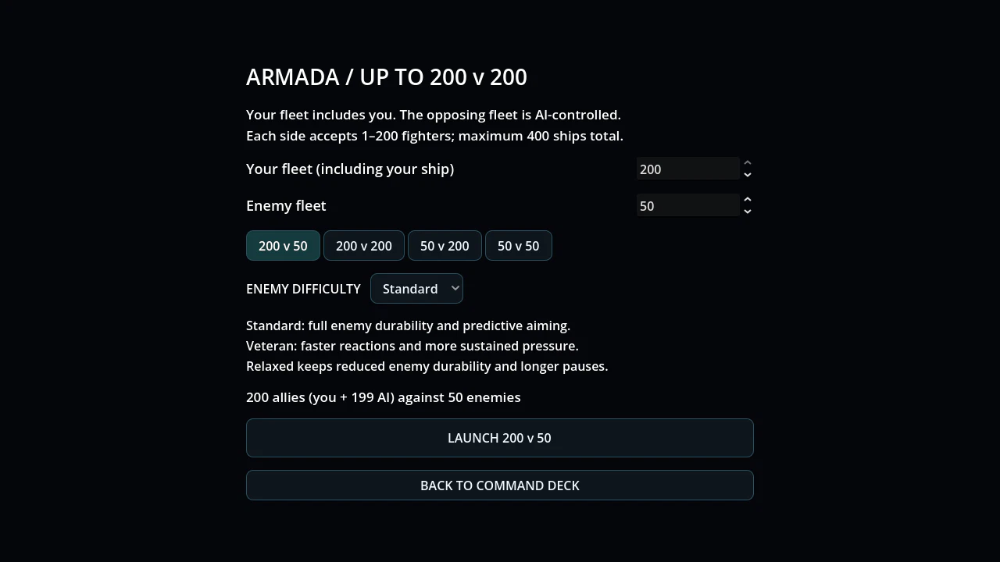

# Armada — 200v50, 200v200 and 50v200

The main menu prominently offers **200 v 50**, **200 v 200** and **50 v 200**, plus **ARMADA / UP TO 200 v 200** for custom fleets. Click a preset, check both counters and difficulty, then select **LAUNCH**. The highlighted setup preset matches the counters; choosing another preset replaces pending typed edits too. Browsing a preset does not change saved sizes until launch.

The left count includes your ship and allied AI: 200 means you + 199 allies; 50 means you + 49 allies. The right count is enemy AI. 200v50 and 50v200 each create 250 ships; 200v200 creates 400. Custom counts remain independently editable from 1–200, and Deploy Again preserves both sides. These are single-player Armada battles. Online remains six human pilot slots; Fleet Royale is 3v3 and Fleet War is 10v10.

`-- --armada` launches saved fleet counts, defaulting to 200v200 for a new profile. The startup log prints `GALACTIC_ARMADA_READY` with the actual friendly, enemy and total ship counts for diagnostics.

## Sector and sensors

The safe sphere begins at radius 5,200m. Each match picks a new seed and scatters forty ten-ship squadrons, sixteen asteroid fields (up to 448 collision asteroids), two stars, two black holes and eight relic sites. Terrain variants and materials are shared instead of generating a unique mesh for every rock. The seed is shown on the chart for diagnostics; tests can supply a seed to `start_armada(seed)`.

Armada enemy targeting and full-durability Standard/Veteran tuning are described in [the AI notes](ARMADA_AI.md). Enemies are initially beyond sensor range. Tab and AI target selection use an 1,100m range. J opens the X/Z chart: allied positions and mapped terrain are visible, enemy positions require local detection. Flight continues; J closes it. The chart closes automatically at the results screen. Sensors are range-based, not an asteroid-occlusion stealth simulation.

Stars influence ships within 650m, producing inward pull and sideways drift. Their 110m hot core deals 55 damage/second through normal shields and protection. Black holes pull within 800m; their 65m event horizon destroys ships. Hazards affect both teams; AI tries to avoid them. Drift is capped and decays outside fields, and boost can help escape. These are accessible arcade rules rather than orbital physics. Damage reports identify stellar corona and black hole causes.

## Fleet and relics

F1–F3 select the first three fitted allies; [ and ] cycle through all survivors. Commands 1–5 apply to the fleet. No respawns; the last fleet standing wins. The zone contracts and collapses after eight minutes under the existing elimination rules.

Approach a relic within 32m if the ship has none. B fires; three charges, 12 seconds between shots, pickup respawn after 90 seconds. Equipment belongs to that live ship and never enters permanent inventory. Both sides can collect and use it.

- Solar Lance: aligned 1,100m beam, 16m target tolerance, 130 damage per enemy. Static obstacles block it and allies are protected. AI waits for alignment within 900m.
- Gravity Nova: 80 damage and a brief slow to enemies within 140m, blocked by obstacles. Allies are protected.

## Architecture and measured limits

`ArmadaSector` owns seeded layouts, hazards, spawn/search points and gravity. `ArmadaChart` presents range-limited contacts. `BattleSpatialIndex` rebuilds alive-ship cells at 10 Hz with conservative margins; exact range tests follow. AI search, Guardian support and repairs use nearby candidates. Obstacle probes run about five times per second in Armada, with cached steering between probes. Relic proximity checks run five times per second and only loaded weapons need AI firing checks.

`ArmadaArt` merges the authored class hull geometry into five shared meshes and team materials. Decorative transparent engine cards are omitted from the merged hull. Taking over promotes a reinforcement to its full model; releasing it restores the merged model. Main fitted ships retain full visuals. Armour palettes and panel wear are refined across ship classes.

Local final benchmark: 2,400 physics frames / 40 simulated seconds in 30.21 wall seconds, 3,243.6 confirmed damage, 190 allied and 182 opposing survivors. This is headless simulation on a shared development machine. It does not measure GPU FPS, prove 400-player networking or replace human playtests.

Run `godot --headless --path . --script res://tests/armada_test.gd --fixed-fps 60` and `res://tests/armada_sector_test.gd` for live combat and sector checks. Test actual Windows graphics, long matches and balance before treating this experimental mode as production-ready.

## v0.45 validation

`tests/armada_presets_test.gd` runs with campaign guidance disabled, matching the default released game. Its 44 checks use the actual menu buttons to launch and replay 200v50, 200v200 and 50v200, verify exact living-ship totals and Armada systems, exercise stale SpinBox edits and arbitrary custom counts, and retain normal 3v3/10v10 navigation. Command-deck and existing Armada checks cover the legacy feature mode as well.

After exporting Linux, run `python3 tests/test_packaged_armada.py build/linux/GalacticDominion.x86_64`. It boots each requested format with isolated settings in the exported client and verifies the actual roster marker without script errors. Release CI runs this check for all three presets. This establishes packaged launch behavior, not Windows frame rates or human battle balance.
