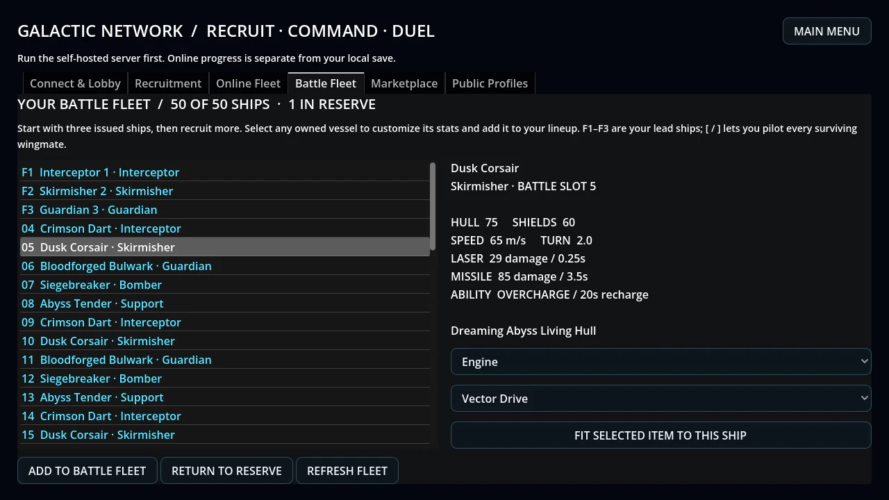

# Recruit, customize and command a fleet

v0.46 adds permanent **online** ship recruitment and two-commander Fleet Duel. Each commander brings **3–50 owned vessels**, with one piloted ship and AI wingmates. A full 50v50 contains two human commanders and 98 AI. You can keep 200 ships in your account and choose a different lineup between matches.

The image uses a throwaway development account with 50 deployed ships; new accounts start with three issued ships and 200 salvage.

## Recruit your first ship

1. Start the matching self-hosted server package. Open **Online**, enter its addresses, and sign in or create an account. [Hosting instructions](../server/README.md).
2. Open **Recruitment**, select a contract, and click **RECRUIT SELECTED SHIP**. The server deducts the displayed salvage price and saves a unique vessel in your reserve. Crew is optional; an AI flight computer can operate every ship.
3. Open **Battle Fleet**, select that vessel, then choose **ADD TO BATTLE FLEET**. The heading shows how many of the 50 deployment slots you have filled. **RETURN TO RESERVE** removes an extra wingmate from the lineup.
4. To replace an F1–F3 lead ship, use **Online Fleet → fleet slot → owned ship → DEPLOY OWNED SHIP**. If the chosen vessel already occupied a wing slot, the former lead ship moves there. Otherwise the former lead ship returns to reserve.

Contracts are repeatable; two interceptors are distinct owned ships and can carry different fittings. Each purchase unlocks its faction livery once and fits that appearance to the recruit. Bloodforged and Dreaming Abyss appearances preserve class stats and abilities.

| Contract | Class | Salvage | Base hull / shields | Speed | Ability |
| --- | --- | ---: | ---: | ---: | --- |
| Crimson Dart | Interceptor | 100 | 50 / 40 | 90 m/s | Speed burst |
| Dusk Corsair | Skirmisher | 120 | 75 / 60 | 65 m/s | Weapon overcharge |
| Bloodforged Bulwark | Guardian | 150 | 110 / 120 | 46 m/s | Nearby ally protection |
| Siegebreaker | Bomber | 180 | 90 / 65 | 48 m/s | Missile barrage |
| Abyss Tender | Support | 160 | 95 / 90 | 54 m/s | Nearby ally repair |

The menu displays the actual Resource-derived stats **after fittings**. The table shows unmodified class values. Class abilities are activated by the pilot with **R** or automatically by a ship's AI.

## Customize all fifty ships

**Battle Fleet** lists every owned vessel, including reserves. Select a ship to inspect hull, shields, speed, turn rate, laser damage/fire interval, missile damage/cooldown, ability and livery. Choose an engine, shield, weapon, utility, crew or appearance and click **FIT SELECTED ITEM TO THIS SHIP**. Fittings save with that vessel when it moves to reserve. The first three ships can also be outfitted through **Online Fleet**.

Owned component schematics can fit multiple vessels. A crew member can serve only one ship in the deployed battle lineup; reserve assignments are checked before deployment. Unassign conflicting crew before adding that reserve ship. Ships without crew remain functional.

Use research, online encounters and battle rewards to obtain additional equipment. A victory grants a permanent tradable hull blueprint. Select it in **Online Fleet** and choose **COMMISSION SELECTED SHIP BLUEPRINT INTO RESERVE** to consume one copy and create an owned vessel. Alternatively, trade the unused blueprint in the existing marketplace. Commissioned and contracted vessel records stay in your account; direct trading of those records is not implemented. An item’s last copy must be removed from active **and reserve** fittings before listing it.

## Fight another commander

1. Both players connect to the same combat host using the same v0.46.0 client. Build and fit your lineups before joining.
2. Exactly two commanders must be present. Choose **TEAM 1** and **TEAM 2**, then both click **READY**.
3. The lobby leader clicks **FLEET DUEL · YOUR FLEET vs THEIR FLEET**. Each side spawns its own selected lineup. Unequal fleets are allowed; for example, seven selected ships can face fifty. The duel uses up to 100 total ships.
4. **F1–F3** select lead ships. **[ / ]** cycle every surviving friendly vessel. The previously piloted ship returns to AI control; destruction transfers control to another survivor. Opponent takeover is rejected by the host.
5. Give orders with **1 Follow, 2 Attack current target, 3 Defend, 4 Regroup, 5 Retreat**. W/S thrust, A/D strafe, Space/Ctrl vertical, mouse aim, Shift boost, LMB lasers, **M missiles**, Tab target, R ability.

Eliminating a fleet ends the match. Otherwise the eight-minute limit compares surviving hull/shields; the shrinking sphere discourages hiding. Leaving an active duel forfeits it. The host credits the commander for all deployed ships' kills and damage, including the final blow between snapshots. Battle destruction does not delete your ships or fittings. New matches repair deployed hulls and shields.

Recruitment, fitting, trading and deployment are locked during combat. Reward settlement is idempotent and retries while the host remains running if the account service is temporarily unavailable. The result screen reports pending saves, and the next match waits for settlement. Return through **DEPLOY AGAIN** to rebuild your fleet and rejoin; it does not silently start an online rematch.

## Saves and implementation

Online accounts use server profile version 2 in `server-data/galaxy.sqlite3`. Existing accounts migrate their exact three hulls and fittings to stable vessel IDs without losing inventory, currency or progression. Back up the server data folder before upgrading. Local schema 11 and local exploration/creature saves remain independent; local profiles cannot award online ships.

The account service owns recruitment prices, receipts, roster limits, fittings and lineup validation. A locked account snapshot supplies hulls/fittings to the Godot host, which derives combat stats from the existing ship and collectible Resources. Live combat and rewards stay host-authoritative.

Large duels send compact eight-ship presentation packets and twelve-projectile batches. Ownership uses full integer peer IDs; projectile visuals reuse instances and expire stale snapshots. Nearby/incoming missile visuals are prioritized, with a 192-projectile presentation budget per client. All projectiles still simulate on the host. AI uses the shared spatial index and cached obstacle casts; additional wingmates use existing simplified hulls, and taking control restores detailed ship art.

Legacy Fleet Royale, six-pilot Free Roam/Co-op, solo 10v10 and the **200v50 / 200v200 / 50v200** Armada formats remain available. Each server runs one session at a time. Public profiles show the deployed fleet and total owned-ship count. Public matchmaking and ranked fleets are future work.

## Validation

- `python3 -m unittest discover -s tests -p 'test_*service.py'`: account migration, simultaneous purchases/retries, capacity/funds, blueprint consumption, all-vessel fitting, fifty-ship deployment, ownership, match locks and permanent settlement alongside market/co-op cases.
- `godot --headless --path . --script res://tests/fleet_recruitment_test.gd --fixed-fps 60`: menu reachability, configured stats, all 100 spawns, packed transport budgets, late ship ownership, HUD bindings and fleet-wide combat credit.
- `python3 tests/test_fleet_duel_network.py`: two actual ENet clients in deterministic 50v50 and 7v50 fixtures; verifies locked fittings, movement/health snapshots, final-wingmate switching, opponent ownership, forfeit and an interrupted account-service result save. The fixture freezes AI and injects health-system eliminations for reproducible attribution.
- `GD_TEST_DUEL_PACKAGED=1 GD_TEST_COMBAT_BINARY=/path/to/GalacticDominion.x86_64 python3 tests/test_fleet_duel_network.py`: normal live 50v50 AI combat on the exported host, with source test clients. The same live path was also run locally using `godot` as the host executable.
- Existing two-client, six-client and disconnected co-op settlement regressions, plus the broader Godot suites, exercise retained systems. Native 1280×720 Linux captures check all four recruitment/fleet/lobby pages. Software-rendered captures report two texture shutdown warnings after closing; gameplay script checks pass. Windows GUI, Internet hosting, physical controllers and sustained human balance/performance playtests remain pending.
